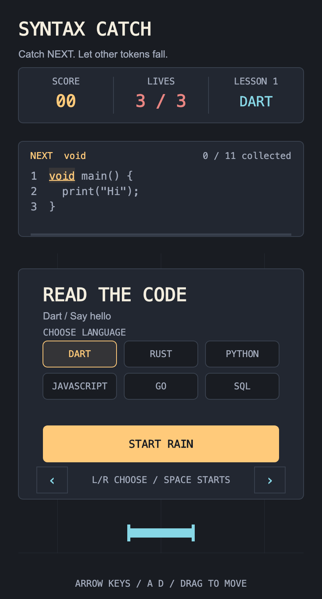

# Syntax Catch



Choose a language tile or use Left/Right in the reading phase. Inspect its code,
then choose **Start rain** or press Space when ready. Selecting a language previews
its code without starting the rain. Each challenge begins with this reading
phase, so you can inspect the full snippet at your own pace.

Catch the next required token to assemble the snippet. Tokens enter the
playfield individually in a continuous stream, with the same pace across
languages. Move under `NEXT` and let unwanted tokens fall past the catcher.
Skipping a token preserves your progress and lives. Catching a wrong token
costs one life, and correct catches add points.

The full target code stays visible in a code editor with line numbers. Collected
code is icy cyan, the next required token is amber, and a progress bar and
counter show how many parts you have collected. A missed required token returns
in the stream. Complete the snippet, then choose **Next code** or press Space to
open the next reading phase. Language selection is available before starting;
the current language stays fixed during play.

Drag or tap to position the catcher, or use Left/Right (A/D). Click the visible
button or press Space to start, continue, or return to the reading phase after
three mistakes. The included challenges cover Dart, Rust, JavaScript, Python,
Go, and SQL.

Challenges are data in `lib/state/syntax_challenges.dart`. Each `SyntaxChallenge`
declares a language label, ordered `CodePart` values, and distractors. A part's
`before` text preserves spaces and line breaks in the displayed source. Add a
challenge by extending this list; language choices come from the authored
challenges. The game displays and matches code as text;
it does not execute snippets or validate alternative programs. Check new
examples with the relevant language tools.
Keep snippets to four short lines for the current code preview; longer lessons
need scrolling.

[Game design notes](docs/game-design.md) explain the research, fairness rules,
and tuning choices that still need player testing.

Use Flutter 3.44.1 / Dart 3.12.1 and Dust CLI 0.3.1. The native runner targets
macOS 12 or newer.

```sh
flutter pub get
dart run tool/generate.dart
flutter run -d macos
```

Web is also included. Use `flutter run -d chrome` or `flutter build web`.
The game uses native Flame shapes and text, without asset setup.

The developer entrypoint is `lib/state.dart`. It exports the scope, models,
generated accessors, and challenge definitions. The game creates one lazy scope.

```dart
ViewModelScope(children: [Playfield(), GameHud()])
```

A component registers its typed reaction once in its constructor or `onLoad`.

```dart
watchScoreViewModel((score) => text = '${score.state.points}');
```

Commands use the generated reader, for example `readHealthViewModel().hit()`.
Component constructors never receive ViewModels. `ScoreViewModel`,
`HealthViewModel`, and `ChallengeViewModel` hold three independent immutable
states. Movement and falling-token collision checks stay in Flame's frame loop.

`lib/game/syntax_catch_game.dart` owns the session scope. Each nearest scope
creates one model per stable generated descriptor on first use and retains it
until removal. Restarting creates a new scope. Watcher subscriptions follow the
component lifecycle, including reparenting. The game explicitly removes its
session subtree on detach, including while paused.

`GameLayout` centralizes board geometry and spacing. `GameStyle` centralizes
semantic color use and the type scale. The terminal-inspired interface uses a
line-number gutter, code progress bar, next-token cue, falling-token trails,
and a bracket-shaped catcher. Language labels fit their stat column. The ready
panel shows up to six language tiles at a time, with previous/next controls and
a 48-pixel start button; buttons activate
on tap completion.

| Token | Role |
| --- | --- |
| Charcoal `#191C22` / slate `#222731` | Game surface and code editor |
| Icy cyan `#87D7E6` | Collected syntax and catcher |
| Amber `#FFCA7A` | Next required token and selected language |
| Coral `#E98582` | Remaining lives and mistake state |
| Display / numeric / language / body / caption / token / code | Consistent text roles |

The scope runtime in `lib/bridge/view_model_scope.dart` is a local prototype.
`tool/generate.dart` reads `@ViewModel` declarations through the Dart analyzer AST
and emits descriptors plus named Flame read/watch helpers. It then invokes the
published Dust CLI for state equality and ViewModel bases. Flame helpers are
part of this review example and are candidates for later Dust integration.

The local generator supports public, concrete, non-generic ViewModels with an
unnamed constructor callable without arguments. Required dependencies receive a
diagnostic. The token stream uses a fixed random seed for repeatable reviews.

```sh
dart run tool/generate.dart --check
flutter analyze
flutter test
flutter build macos --debug
flutter build web
```

`--check` detects stale generated helpers without writing files, then runs
`dust check`. Tests cover generator validation, lazy scope ownership, watcher
rebinding and cleanup, the reading phase, language selection, correct/wrong
catches, full-code completion, and reset.
